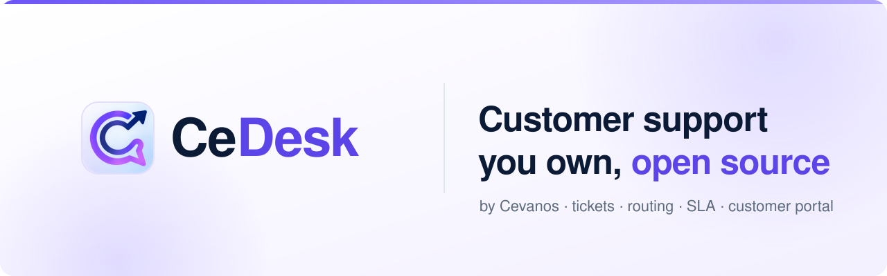
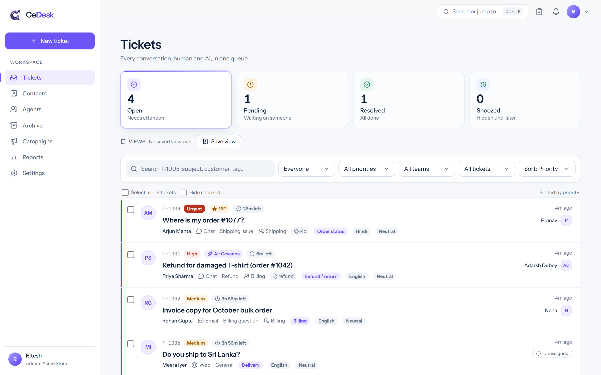
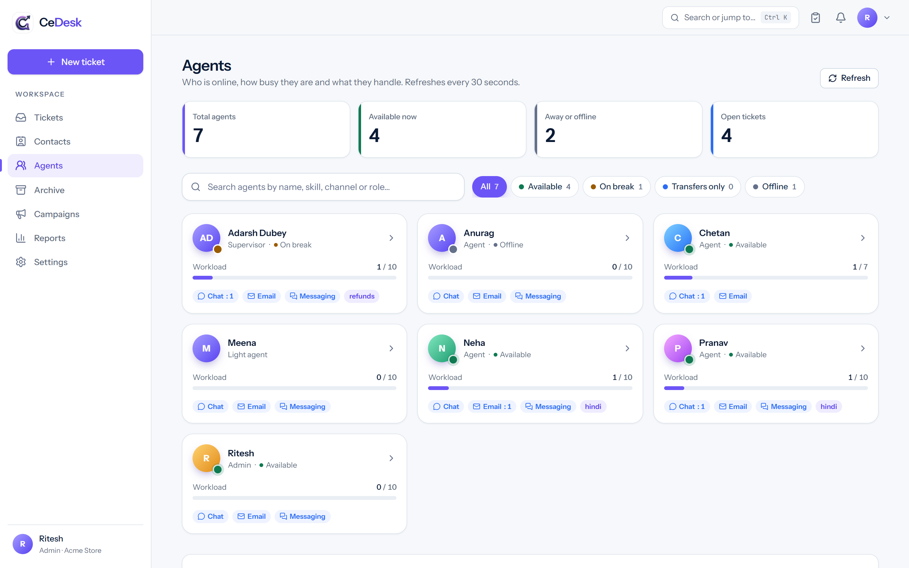
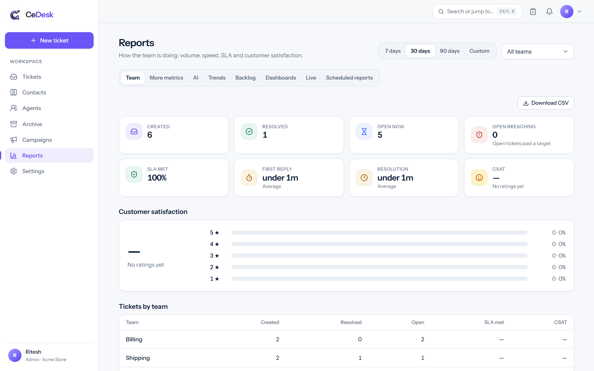
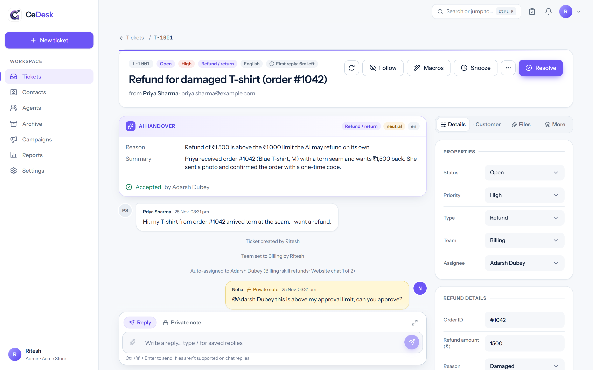
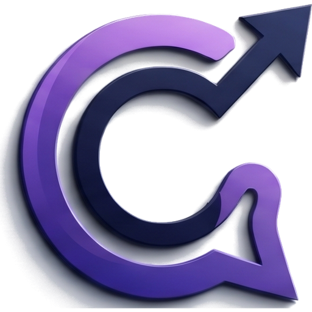

<p align="center">
  <a href="https://cevanos.ai">
    <picture>
      <source media="(prefers-color-scheme: dark)" srcset=".github/assets/banner-dark.svg">
      
    </picture>
  </a>
</p>

<h1 align="center">CeDesk</h1>

<p align="center">
  <b>The open-source help desk by <a href="https://cevanos.ai">Cevanos</a>.</b><br>
  Tickets, routing, SLAs, macros, rules, a customer portal and one-click imports, on your own server.<br>
  An open-source alternative to Zendesk, Freshdesk and Help Scout.
</p>

<p align="center">
  <a href="https://github.com/Cevanos/CeDesk/actions/workflows/ci.yml"></a>
  <a href="https://github.com/Cevanos/CeDesk/actions/workflows/docker.yml"></a>
  <br>
  <a href="LICENSE"></a>
  
  
  
  <a href="CONTRIBUTING.md"></a>
</p>

<p align="center">
  <a href="docs/SELF_HOSTING.md"></a>
  &nbsp;
  <a href="https://cevanos.ai"></a>
</p>

<p align="center">
  <a href="docs/SELF_HOSTING.md">Self-hosting</a> ·
  <a href="docs/SETTINGS.md">Settings</a> ·
  <a href="docs/api">API</a> ·
  <a href="docs/DEVELOPMENT.md">Developing</a> ·
  <a href="CONTRIBUTING.md">Contributing</a> ·
  <a href="https://cevanos.ai">Cevanos</a>
</p>

<p align="center">
  <picture>
    <source media="(prefers-color-scheme: dark)" srcset=".github/assets/screenshots/inbox-dark.png">
    
  </picture>
</p>

---

## Why CeDesk

- **Yours.** Your server, your database, your customers' data. Self-hosted CeDesk has every feature and no plan limits.
- **Complete.** A real help desk out of the box: queues, routing, SLAs, automations, a customer portal and reports.
- **Easy to move to.** Bring your tickets over from Zendesk, Freshdesk, Intercom, Help Scout or a CSV file.
- **AI when you want it.** Works fully on its own. Connect a [Cevanos](https://cevanos.ai) workspace to add an AI agent with clean AI-to-human handover.

## Features

<table>
  <tr>
    <td width="50%" valign="top">
      <h3>📥 Shared inbox</h3>
      Status tabs, search, filters and sorting, live updates, private notes, saved replies, side conversations and a command palette (<kbd>Ctrl</kbd>/<kbd>⌘</kbd> <kbd>K</kbd>).
    </td>
    <td width="50%" valign="top">
      <h3>🧭 Routing and SLA</h3>
      Teams, skills, capacity and agent availability decide who gets each ticket. SLA policies track first reply and resolution times.
    </td>
  </tr>
  <tr>
    <td valign="top">
      <h3>⚡ Macros and rules</h3>
      One-click macros, automation rules, auto-close and custom ticket types and fields, so repeat work does itself.
    </td>
    <td valign="top">
      <h3>🌐 Customer portal</h3>
      A help center, contact form, ticket view and CSAT ratings for your customers, with no agent sign-in needed.
    </td>
  </tr>
  <tr>
    <td valign="top">
      <h3>📊 Reports</h3>
      Team reports, dashboards, saved and scheduled reports, and help-article votes.
    </td>
    <td valign="top">
      <h3>🔁 Imports</h3>
      Move from Zendesk, Freshdesk, Intercom, Help Scout or CSV, with resume and retries for large accounts.
    </td>
  </tr>
  <tr>
    <td valign="top">
      <h3>🔐 Secure by design</h3>
      Four roles, single sign-on, two-factor sign-in, an audit log, and row-level security that keeps every workspace's data apart in the database.
    </td>
    <td valign="top">
      <h3>🔌 Open and connected</h3>
      Email in and out, a documented REST API, webhooks, API keys, Jira, and file storage on disk, S3, Google Cloud or Azure.
    </td>
  </tr>
</table>

<table>
  <tr>
    <td width="50%"></td>
    <td width="50%"></td>
  </tr>
  <tr>
    <td align="center"><sub><b>Agents.</b> Availability, workload, channels and skills at a glance.</sub></td>
    <td align="center"><sub><b>Reports.</b> Volume, speed, SLA and customer satisfaction.</sub></td>
  </tr>
</table>

## Better with Cevanos

CeDesk is a complete help desk on its own. Connect a [Cevanos](https://cevanos.ai) workspace and it gains:

| | |
|---|---|
| 🤖 **AI agent** | Cevanos answers customers first, around the clock. |
| 🤝 **AI-to-human handover** | When the AI escalates, the conversation lands in CeDesk as a ticket with the full chat. |
| 💬 **Cevanos chat channels** | Customer chats from Cevanos channels flow into the same queue. |
| ✍️ **AI writing help** | Summaries, reply drafts and translation for your agents. |

<p align="center">
  
  <br>
  <sub>A ticket handed over by the Cevanos AI, with the reason, a summary and the full conversation.</sub>
</p>

The link is one module over Cevanos's public API. With no key set, CeDesk never calls Cevanos and the Cevanos features stay hidden. Setup: [Self-hosting > Cevanos](docs/SELF_HOSTING.md#cevanos-optional).

## Get started

### Self-host with Docker

All you need is a Linux server with Docker and a domain name. One command runs Postgres, the API, a worker, the web app and Caddy (which gets your HTTPS certificate on its own).

```bash
git clone https://github.com/Cevanos/CeDesk.git && cd CeDesk/deploy
cp env.example .env        # fill in passwords, your domain and SMTP
docker compose up -d --build
```

The full guide, with email, backups, updates and single sign-on: **[docs/SELF_HOSTING.md](docs/SELF_HOSTING.md)**. Every setting: [docs/SETTINGS.md](docs/SETTINGS.md).

### Run it locally for development

```bash
uv sync && docker compose up -d db && cp .env.example .env
uv run cedesk migrate
uv run cedesk create-workspace --name "Acme" --slug acme \
    --admin-email you@example.com --admin-name "Your Name"   # asks for a password
uv run cedesk serve --reload          # API on http://127.0.0.1:8100, docs at /docs
cd frontend && cp .env.example .env.local && npm install && npm run dev   # web app on :3000
```

Step by step, with tests and the rules every change keeps: [docs/DEVELOPMENT.md](docs/DEVELOPMENT.md) and [frontend/README.md](frontend/README.md).

## Built with

- **Backend:** Python 3.12, FastAPI, SQLAlchemy, Alembic, PostgreSQL 17 with row-level security.
- **Web app:** Next.js 16, React 19, TypeScript, Tailwind CSS 4, TanStack Query.
- **Deploy:** Docker Compose and Caddy on one server.

## Contributing

We'd love your help, whether that's a bug report, a fix, a translation or a new feature.

- Read the [contributing guide](CONTRIBUTING.md) and the [code of conduct](CODE_OF_CONDUCT.md).
- Found a bug or have an idea? [Open an issue](https://github.com/Cevanos/CeDesk/issues/new/choose).
- Found a security problem? Please follow [SECURITY.md](SECURITY.md) instead of opening a public issue.

<a href="https://github.com/Cevanos/CeDesk/graphs/contributors">
  
</a>

## License

CeDesk is open source under the [MIT License](LICENSE), copyright © 2026 Cevanos.

Cevanos AI, CeDesk Cloud (managed hosting) and enterprise-only features are separate commercial products from Cevanos and are not part of this repository.

<p align="center">
  <br>
  <a href="https://cevanos.ai"></a><br>
  <sub>Made with 💜 by the <a href="https://cevanos.ai">Cevanos</a> team</sub>
</p>
