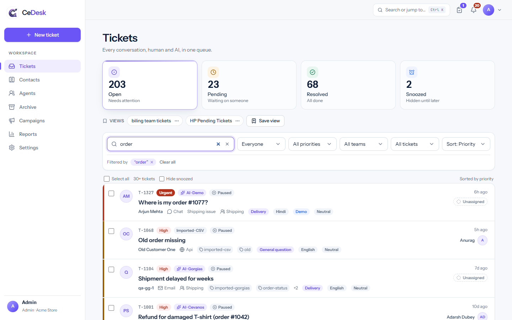
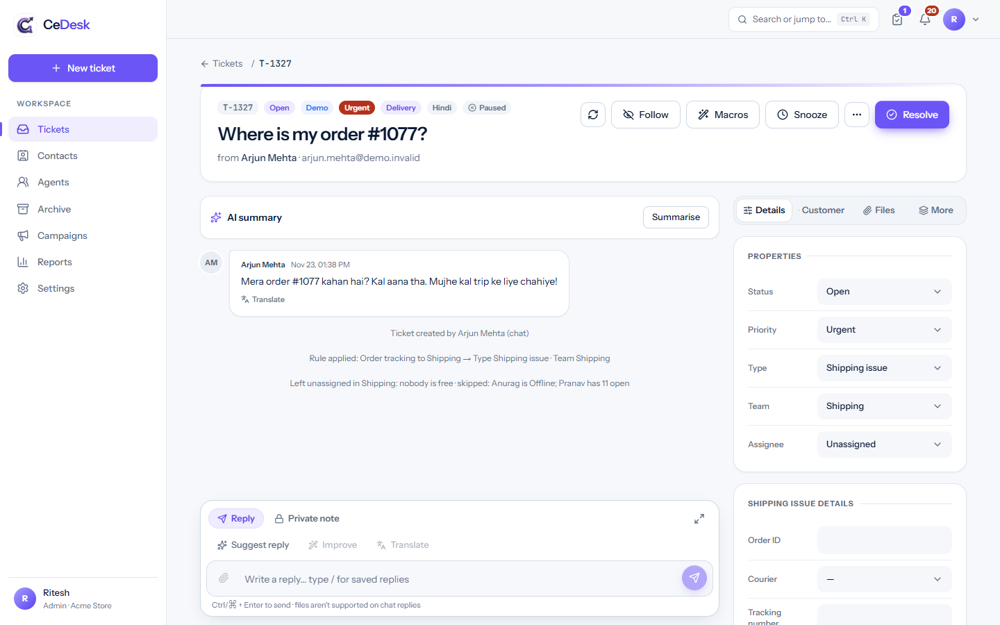

# CDesk Frontend

Web frontend for CDesk, a customer support desk. Agents, supervisors and admins use it to work a shared ticket inbox, reply to customers, and manage the workspace. It is a Next.js 16 (App Router) app with React 19, TypeScript, Tailwind CSS 4, TanStack Query, React Hook Form + Zod and next-intl.

## Screenshots

Captured from the app running against the sample data in `e2e/mock-backend.ts`, not a real workspace.





## What it does

- Ticket inbox with status tabs, search, filters and sorting. Filters live in the URL.
- Ticket detail with the conversation thread, reply and private-note composer, saved replies, macros, SLA info, properties, customer and files tabs.
- Customer profiles and an agent roster with availability, skills and capacity.
- Admin settings for members, teams, ticket types, SLA, rules, macros, saved replies, email addresses and the Cevanos AI channel.
- Four roles (Light agent, Agent, Supervisor, Admin). The UI hides or disables what a role can't do, and the API enforces it.
- Command palette (Ctrl/Cmd K), notifications, light/dark theme, offline banner.
- Customer-facing pages that need no agent sign-in: portal, contact form, help center, ticket view and CSAT rating.
- Live updates: new messages and reassignments are pushed to agents and customers.
- Reports (team report, help-article votes) and ticket import from another help desk (Settings > Imports).

## Quick start

```bash
cp .env.example .env.local   # set CDESK_API_URL
npm install                  # also installs the git hooks
npm run dev                  # http://localhost:3000
```

Needs Node 20.19+ and npm 10+ (`.nvmrc` pins 22, which CI and the Dockerfile also use). The backend API only allows origins `:3000` and `:5173`.

## Scripts

| Script                                      | What it does                                                            |
| ------------------------------------------- | ----------------------------------------------------------------------- |
| `npm run dev` / `build` / `start`           | Next.js dev server, production build, production server                 |
| `npm run lint` / `lint:fix`                 | ESLint                                                                  |
| `npm run typecheck`                         | `tsc --noEmit`                                                          |
| `npm run format` / `format:check`           | Prettier                                                                |
| `npm test` / `test:watch` / `test:coverage` | Vitest, Testing Library, MSW                                            |
| `npm run test:e2e`                          | Playwright against a production build and `e2e/mock-backend.ts`         |
| `npm run validate`                          | typecheck, lint, format check, tests, build (what CI runs)              |
| `npm run analyze`                           | Bundle analyser (JS only, see note)                                     |
| `npm run gen:api`                           | Generate API types: `OPENAPI_SPEC=path/to/openapi.json npm run gen:api` |
| `npm run audit`                             | `npm audit` for production dependencies                                 |

`npm run analyze` builds with webpack for `@next/bundle-analyzer`. Tailwind is wired through Turbopack here, so that build does not generate Tailwind CSS (about 28 KB of CSS versus 89 KB in the normal build). Use it for JavaScript bundle sizes only.

Before the first e2e run: `npx playwright install chromium`.

## Configuration

| Variable                        | Scope       | Notes                                                                                                                                                                            |
| ------------------------------- | ----------- | -------------------------------------------------------------------------------------------------------------------------------------------------------------------------------- |
| `CDESK_API_URL`                 | server only | Required. Checked at boot in `src/instrumentation.ts`.                                                                                                                           |
| `AUTH_RATE_LIMIT_PER_MINUTE`    | server only | Optional. Sign-in attempts per client per minute, default 10.                                                                                                                    |
| `TRUSTED_PROXY_HOPS`            | server only | Optional, default 1. Number of reverse proxies that append to `X-Forwarded-For`; 0 if the app is exposed directly. Too high lets clients fake their IP and dodge the rate limit. |
| `ALLOW_INSECURE_HTTP`           | server only | Optional, test/staging only. `1` drops the `Secure` cookie flag and `upgrade-insecure-requests` so the app works over plain HTTP. Never set in production.                       |
| `NEXT_PUBLIC_DEFAULT_WORKSPACE` | public      | Optional. Pre-fills the workspace field on sign-in.                                                                                                                              |
| `NEXT_PUBLIC_API_PUBLIC_URL`    | public      | Optional. Backend public address, only used to show the Cevanos webhook URL in Settings.                                                                                         |

## Architecture

- **Browser to this app only.** Client code calls `/api/*` on its own origin. The catch-all route handler (`src/app/api/[...path]/route.ts`) forwards to `CDESK_API_URL` server to server, attaches the session from an httpOnly cookie, and enforces the allow-list, same-origin and rate-limit guards.
- **`src/proxy.ts`** (Next.js 16 Proxy, formerly middleware) redirects signed-out users away from agent pages, lets customer pages through (`src/lib/public-routes.ts`), and sets the per-request CSP nonce.
- **Server state** lives in TanStack Query. Hooks in `src/hooks` own the fetching, and every cache key comes from `src/lib/api/query-keys.ts`. Responses are checked with Zod at the API boundary.
- **Rendering.** The agent app is rendered per request (it depends on the session cookie), so build output shows those routes as dynamic. Server-only code is marked with `server-only`.
- **Roles** (`src/lib/permissions.ts`) decide what the UI shows. The backend is the authority.

Decisions with trade-offs are written up in [docs/adr](docs/adr).

## Security notes

- The browser only calls `/api/*` on this app. `src/app/api/[...path]/route.ts` forwards to `CDESK_API_URL` server to server, so the backend URL never reaches the client.
- The session token is stored in an httpOnly cookie (`SameSite=Lax`, `Secure` in production) and removed from the sign-in response. See [ADR 0001](docs/adr/0001-httponly-session-cookie.md).
- The CSP uses a per-request nonce with `strict-dynamic`, no `unsafe-inline` for scripts. See [ADR 0002](docs/adr/0002-csp-nonce.md).
- The proxy only forwards allow-listed API areas, rejects odd path segments, and checks same-origin on mutating requests.
- Sign-in and password-reset calls are rate limited in memory per client. The backend is still the authority.
- `?next=` redirects are limited to same-origin relative paths (`src/lib/safe-next.ts`).
- Environment variables are validated with Zod at boot; production won't start with a bad `CDESK_API_URL`.

To report a vulnerability, see [SECURITY.md](SECURITY.md).

## Project structure

```
src/
  proxy.ts            route guard, CSP nonce, security headers
  instrumentation.ts  boot-time env validation
  app/
    (auth)/           login, forgot and reset password
    (app)/            signed-in area: tickets, customers, agents, reports, settings
    (public)/         customer pages: portal, contact, help center, ticket view, CSAT rating
    robots.ts         robots.txt (disallow all; the app is not meant to be indexed)
    api/[...path]/    proxy to the CDesk API
    api/health/       health probe
    dev/ui/           component gallery (development only)
  components/         auth, feedback, layout, providers, public, tickets, workspace, ui
  hooks/              TanStack Query hooks and small UI hooks
  lib/
    api/              fetch client, Zod schemas, types, query keys
    server/           env, config, rate limiter, proxy guards (server-only)
    csp.ts, permissions.ts, monitoring.ts, safe-next.ts
  i18n/               next-intl request config
  test/               fixtures, render helper, MSW server
messages/en.json      UI strings
e2e/                  Playwright specs and mock backend
docs/adr/             architecture decision records
```

Unit and component tests sit next to the code they cover (`*.test.ts(x)`).

## Deploying

```bash
docker build -t cdesk-frontend .
docker run -p 3000:3000 -e CDESK_API_URL=https://api.example.com/api/v1 cdesk-frontend
```

`/api/health` returns 200 when the app is configured and 503 when it isn't, so it works as a liveness and readiness probe. Behind a reverse proxy, make sure it sets `X-Forwarded-For` and set `TRUSTED_PROXY_HOPS` to match.

## Troubleshooting

| Symptom                                                       | Likely cause                                                                                                                                                                                                      |
| ------------------------------------------------------------- | ----------------------------------------------------------------------------------------------------------------------------------------------------------------------------------------------------------------- |
| App shows a configuration error, or `/api/health` returns 503 | `CDESK_API_URL` is missing or not a valid URL. Copy `.env.example` to `.env.local` and set it.                                                                                                                    |
| Browser requests to the backend fail with a CORS error        | The browser should only call `/api/*` on this app. The backend only allows origins `:3000` and `:5173`, so run the dev server on one of those ports.                                                              |
| Sign-in works but you are signed out immediately              | The `Secure` cookie flag is set in production builds, so over plain `http://` the browser drops the cookie. Use HTTPS (or, for a throwaway HTTP test server only, `ALLOW_INSECURE_HTTP=1`), or run `npm run dev`. |
| Rate-limit errors (429) on sign-in behind a proxy             | `TRUSTED_PROXY_HOPS` doesn't match the number of proxies in front of the app.                                                                                                                                     |
| `npm install` refuses to run                                  | `engine-strict` is on. Use Node 20.19+ (`nvm use`).                                                                                                                                                               |
| E2E tests can't launch a browser                              | Run `npx playwright install chromium` once.                                                                                                                                                                       |

## Roadmap

There is no published roadmap yet. Planned work and ideas are tracked in GitHub issues.

## Contributing

See [CONTRIBUTING.md](CONTRIBUTING.md) and the [Code of Conduct](CODE_OF_CONDUCT.md). Changes are listed in [CHANGELOG.md](CHANGELOG.md).

## License

[MIT](LICENSE) © 2026 Cevanos.

## Acknowledgements

Built with [Next.js](https://nextjs.org), [React](https://react.dev), [Tailwind CSS](https://tailwindcss.com), [TanStack Query](https://tanstack.com/query), [React Hook Form](https://react-hook-form.com), [Zod](https://zod.dev), [next-intl](https://next-intl.dev), [Lucide](https://lucide.dev), [Vitest](https://vitest.dev) and [Playwright](https://playwright.dev).
